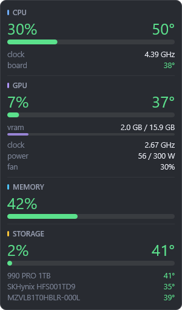

<p align="center">
  
</p>

<h1 align="center">Vitals</h1>

<p align="center">
  A hotkey hardware-stats panel for Windows: CPU, NVIDIA GPU, memory and NVMe
  temperatures, always on top, with no installer and no kernel driver.
</p>

<p align="center">
  <a href="https://github.com/BBareth/vitals/actions/workflows/ci.yml"></a>
  <a href="https://github.com/BBareth/vitals/releases/latest"></a>
  <a href="./LICENSE"></a>
  
  
</p>

---

Vitals floats a small panel over everything on the monitor you choose and
toggles it with `Win+Alt+O`. Think of the Game Bar's performance widget, but
permanent, readable from across the room, and with real sensor data.

<p align="center">
  
</p>

- **CPU**: load, real turbo clock, package temperature, and the mainboard
  temperature when a sensor bridge is connected
- **GPU** (NVIDIA): load, temperature, VRAM, core clock, power against the
  board limit, fan
- **Memory**: load
- **Storage**: activity, and the temperature of every NVMe drive

The panel is small on purpose: **300 px wide**, about the footprint of the Game
Bar's own widget. It leads with large percentages and temperatures. Two extras
are off by default and take one flag each: per-thread P-core/E-core bars
(`cpu_cores`) and network throughput (`network`).

It is written in Rust against raw Win32 and Direct2D, and ships as a single
**~1 MB** `vitals.exe`. There is no installer, no service and no kernel driver.
On the machine it was built on, the panel idles at **~0.01% CPU and ~13 MB**.

## Contents

- [Install](#install)
- [Use](#use)
- [CPU temperature](#cpu-temperature)
- [Configuration](#configuration)
- [How it works](#how-it-works)
- [Why the GPU runs in its own process](#why-the-gpu-runs-in-its-own-process)
- [Troubleshooting](#troubleshooting)
- [Not covered](#not-covered)
- [Building from source](#building-from-source)
- [License](#license)

## Install

Download `vitals.exe` from the
[latest release](https://github.com/BBareth/vitals/releases/latest), put it
anywhere, and run it. Right-click the tray icon and pick **Start with Windows**
if you want it always up.

The binary is not code-signed, so the first run shows SmartScreen's *Windows
protected your PC*. Click **More info → Run anyway**. Every release also ships
`SHA256SUMS.txt`, so you can check the download first:

```powershell
(Get-FileHash .\vitals.exe -Algorithm SHA256).Hash
```

Requirements:

- Windows 11, x64. Windows 10 should work but is not tested.
- An NVIDIA driver for the GPU section. Without one, the section says why it
  is empty and everything else works.

Vitals writes only to `%APPDATA%\Vitals\` (`config.toml` and `vitals.log`).
**Start with Windows** adds a `Vitals` value under
`HKCU\Software\Microsoft\Windows\CurrentVersion\Run`. To uninstall, untick
**Start with Windows**, quit from the tray, and delete the exe and that folder.

## Use

| Action | How |
| --- | --- |
| Show / hide | `Win+Alt+O`, or left-click the tray icon |
| Settings | Right-click the tray icon |
| Move it | Turn off **Click-through**, drag it, and the new spot is saved |
| Change monitor | **Move to next monitor**, or set `monitor` in the config |
| Everything else | **Edit config file**, then **Reload config**. No restart needed |

`Win+Alt+O` was chosen because nothing in Windows or the Game Bar claims it
(`Win+Alt+G` is the Game Bar's "record that"). Any `Ctrl`/`Alt`/`Shift`/`Win`
combination works. A modifier is required, since a bare key would be swallowed
system-wide.

The panel is click-through by default, so it never steals a click even though it
sits above every other window. Hovering the tray icon shows the current readings
and, when a bridge is connected, which sensor the CPU temperature comes from.

## CPU temperature

Everything above works out of the box, with no driver and no admin rights,
except one reading: **CPU package temperature**.

Reading it requires MSR access, and MSR access requires a kernel driver. Every
tool that reports CPU temperature on Windows ships one. For years that was
WinRing0, which Microsoft Defender flags as `HackTool:Win32/Winring0` over
[CVE-2020-14979](https://github.com/LibreHardwareMonitor/LibreHardwareMonitor/issues/1660).
LibreHardwareMonitor
[replaced it with PawnIO in v0.9.5](https://github.com/LibreHardwareMonitor/LibreHardwareMonitor/pull/1857)
(January 2026), a signed driver that does not trip the detection. The driverless
reading Windows does offer, the ACPI thermal zone, is not a CPU sensor: on a
desktop it reports one chassis value in the high twenties.

So Vitals ships no driver. It reads the temperature from a tool you already
trust, if you run one:

| `bridge.source` | Requires |
| --- | --- |
| `auto` (default) | tries HWiNFO, then LibreHardwareMonitor |
| `hwinfo` | HWiNFO with *Settings → Shared Memory Support* |
| `lhm` | LibreHardwareMonitor with *Options → Remote Web Server* |
| `none` | never looks; the temperature shows a dash |

Both are polled on a background thread, so neither can stall the panel. The
first one that answers supplies the reading, plus a mainboard temperature when
the tool reports one. With no bridge, the CPU temperature shows a dash with
`no sensor source` underneath, as in the screenshot, so it does not look broken.

HWiNFO's free build **turns its shared memory interface off after 12 hours**,
and you have to turn it back on by hand. That is HWiNFO's licensing, not a Vitals
limit. LibreHardwareMonitor has no such limit.

If you use the LibreHardwareMonitor bridge, change two of its settings:

- Turn off every hardware category except CPU and mainboard. Vitals already
  reads the GPU through NVML and drive temperatures through NVMe SMART, so
  polling them there again is wasted work.
- Set its update interval to 2 seconds, to match the bridge's poll.

Its web server also listens on every interface with no authentication by
default, so restrict it to loopback or firewall the port.

## Configuration

`%APPDATA%\Vitals\config.toml` is created with comments on first run. Edit it,
then pick **Reload config** from the tray menu.

```toml
[window]
monitor       = 2            # 1 = primary display, 2 = second, ...
anchor        = "top-right"  # top-left | top-right | bottom-left | bottom-right | center
margin_x      = 24
margin_y      = 24
width         = 300          # logical pixels; scaled by the monitor's DPI
opacity       = 1.0          # lower for a translucent panel
click_through = true         # false lets you drag the panel with the mouse
start_hidden  = false
scale         = 1.0          # extra size multiplier on top of DPI scaling

[hotkey]
toggle = "Win+Alt+O"

[update]
interval_ms = 1000

[panels]
cpu       = true
cpu_cores = false            # per-thread P/E core bars; adds about 35 px
gpu       = true
memory    = true
disk      = true
network   = false            # down/up throughput rows

[bridge]
source  = "auto"             # auto | hwinfo | lhm | none
lhm_url = "http://127.0.0.1:8085/data.json"
```

Monitors are numbered **1 = primary, then left to right**. That order survives
driver updates; the raw enumeration order does not. A malformed file is never
overwritten: Vitals falls back to the defaults and writes the parse error to
`vitals.log`.

## How it works

| Reading | Source |
| --- | --- |
| CPU load, per thread | `NtQuerySystemInformation(SystemProcessorPerformanceInformation)` |
| P-core vs E-core | `GetLogicalProcessorInformationEx`, `EfficiencyClass` |
| CPU clock | PDH `% Processor Performance` × base clock, so turbo is real |
| Memory | `GlobalMemoryStatusEx`, `GetPerformanceInfo` |
| GPU | NVML (`nvml.dll`, ships with the NVIDIA driver), in a child process |
| Drive temperature | NVMe SMART log page `0x02` via `IOCTL_STORAGE_QUERY_PROPERTY` |
| Disk / network throughput | PDH `PhysicalDisk`, `GetIfTable2` |
| CPU and board temperature | HWiNFO shared memory, or LibreHardwareMonitor JSON |

The window is layered, topmost and per-pixel alpha. Direct2D renders into a DIB,
and `UpdateLayeredWindow` pushes it to the screen. That gives rounded corners
and real transparency over any window beneath it, without holding a GPU
swapchain open for something that changes once a second. The renderer runs the
layout twice per frame, once to measure and once to draw, so the panel is always
exactly as tall as the sections you enabled.

Drive SMART data is polled every fifth tick, not every tick. Both processes give
back the memory they only needed while starting up, which is what keeps the
panel near 13 MB.

## Why the GPU runs in its own process

NVML is loaded from the NVIDIA driver. When the driver is updated while a
program has `nvml.dll` loaded, the old library stays mapped while the driver
underneath it is replaced, and the next NVML call can crash with an access
violation inside `nvml.dll`. Before 0.1.0 that took the whole panel down after
every driver update.

So the panel never loads NVML itself. It starts `vitals.exe --gpu-helper`, which
polls NVML and prints one line per sample. The panel supervises it:

- If the helper crashes, exits or goes silent, the panel restarts it with
  backoff (1 s, doubling up to 60 s) and the GPU section reads
  `nvidia restarting` for a moment. Every other section keeps updating.
- When Windows reports a display adapter arriving or leaving, which is what a
  driver install looks like, the panel restarts the helper on purpose, so it
  loads the new driver's `nvml.dll`.
- The helper runs in a job object, so it never outlives the panel.

The helper trims its own working set to about 1 MB. NVML still commits about
22 MB in it, which shows up as private memory in Task Manager.

## Troubleshooting

`%APPDATA%\Vitals\vitals.log` records every GPU helper restart and why it
happened (crash code, exit, silence, or a driver change), and why a
`config.toml` was rejected. It is capped at 64 KB.

| You see | Meaning |
| --- | --- |
| `nvidia restarting` | The GPU helper is being restarted. Normal for a few seconds after a driver update |
| A reason under **GPU** | NVML could not start: no NVIDIA GPU, or no driver. The log has the error |
| `no sensor source` under CPU temperature | No bridge answered. See [CPU temperature](#cpu-temperature) |
| A drive without a temperature | Only NVMe drives report one; SATA and USB drives show activity only |
| Settings ignored after an edit | `config.toml` did not parse, so the defaults are in use. The log names the line |

## Not covered

- **AMD and Intel GPUs.** GPU telemetry is NVML only. AMD would need ADLX and
  Intel would need IGCL. The panel names the reason instead.
- **Fan RPM and voltages.** They have the same MSR/Super I/O problem as CPU
  temperature.
- **Per-process breakdown.** This is a hardware panel, not a task manager.
- **Other operating systems.** Vitals is a Win32 program and only builds on
  Windows.

## Building from source

You need Rust 1.88 or newer with the MSVC toolchain.

```powershell
cargo build --release
```

The result is `target\release\vitals.exe`. CI runs `cargo fmt --check`,
`cargo clippy -D warnings`, the tests, and a smoke test of the GPU helper on
`windows-latest`. Pushing a `vX.Y.Z` tag that matches `Cargo.toml` builds the
release, and the release notes come from [CHANGELOG.md](./CHANGELOG.md).

## License

[MIT](./LICENSE)
